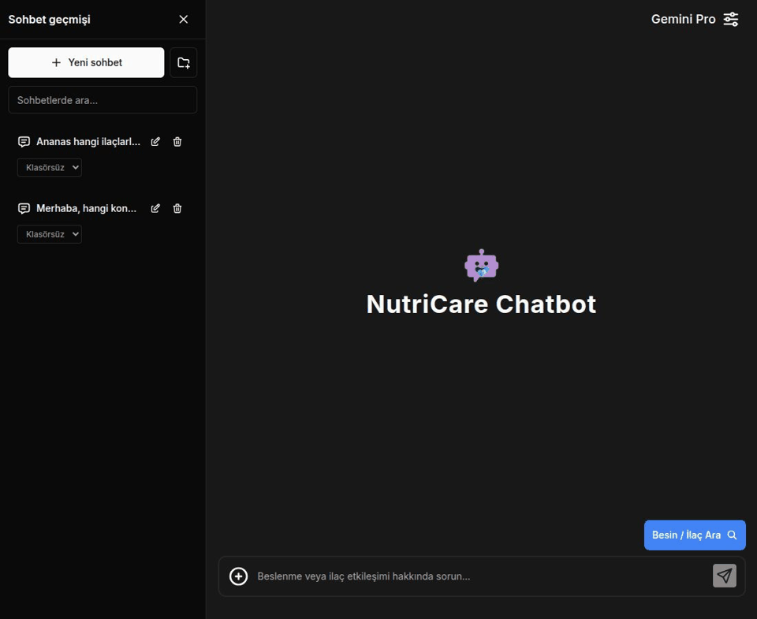
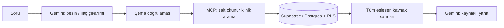

# NutriCare 🌿

**Beslenme ve ilaç–besin etkileşimleri için kaynaklı sohbet asistanı.**

[🌐 Canlı uygulama — www.nutricaretek.com](https://www.nutricaretek.com)

NutriCare, sorudaki besin ve ilaç adlarını çıkarır; Supabase/Postgres kayıtlarını MCP üzerinden sorgular ve yanıtını ilgili kayıtlar ile kaynaklarına dayandırır. Veri bulunmadığında bunu belirtir. Belirsiz klinik durumlarda hekime danışmayı önerir; kendisini gerçek hekim olarak tanıtmaz, tanı veya kişiye özel reçete üretmez.

## Kısa tanıtım



Demo, uygulamanın gerçek ekranlarından kaydedilir. Örnek soru genel bilgilendirme içindir; kullanıcıya ait sağlık verisi veya API anahtarı içermez.

## Neler sunar?

- **Kaynaklı sohbet:** Besin ve ilaç adlarının JSON çıkarımı → doğrulama → MCP aracı → yapılandırılmış veriyle RAG → kayıt kimlikli yanıt.
- **Besin / ilaç araması:** Etken madde, etkileşen ilaç, mekanizma, risk grubu, yönetim ve orijinal kaynak alanları.
- **Sohbet oturumları ve klasörler:** Geçmişte arama; klasör oluşturma, yeniden adlandırma ve sohbetleri klasörlere taşıma. Klasör kaldırıldığında sohbetler korunur.
- **İki sekmeli ayarlar:** Yalnızca model seçimi ve kişisel Gemini API anahtarı. Kişisel anahtar verilmezse uygulamanın mevcut anahtarı kullanılır.
- **Bekleme animasyonu:** Yanıtın ilk parçasına kadar logo küçülür; daire, üçgen ve kare çizimleri oynar. Yanıt gelince animasyon durur. Azaltılmış hareket tercihi desteklenir.
- **E-posta doğrulaması:** Kayıt onayı, doğrulama postasını yeniden gönderme ve şifre sıfırlama.

## Mimari



MCP istemcisi ve sunucusu resmi TypeScript SDK'nın `InMemoryTransport` taşımasıyla aynı sunucu işlemi içinde çalışır. İnternete açık bir SQL/MCP yürütme endpoint'i yoktur. Klinik kaynaklar `nutricare` ve `food_interactions` tablolarında tutulur. Satırlar 200'lük sayfalarla okunur; 2.000 satır veya 120.000 karakter sınırında sonuç sessizce kesilmez, daha dar bir soru istenir. Vektör veritabanı bu yapılandırılmış klinik arama için gerekli değildir.

## Yerel kurulum

```bash
npm ci
cp .env.local.example .env.local
npm run dev
```

Gerekli ortam değişkenleri:

| Değişken | Kullanım |
| --- | --- |
| `NEXT_PUBLIC_SUPABASE_URL` | Supabase proje URL'si |
| `NEXT_PUBLIC_SUPABASE_ANON_KEY` | RLS ile kullanılan public/anon anahtar |
| `GOOGLE_GEMINI_API_KEY` | Sunucuda kalan ortak Gemini anahtarı |
| `SUPABASE_SERVICE_ROLE_KEY` | Yalnız sunucudaki dosya işleme işlemleri için |

Kişisel Gemini anahtarı **yalnız açık sekmenin belleğinde** tutulur; localStorage, sessionStorage, sohbet kaydı veya veritabanına yazılmaz. Sayfa yenilendiğinde silinir. HTTPS üzerinden aynı uygulamanın oturum kontrollü sohbet endpoint'ine iletilir ve yalnız sabit Google Gemini sağlayıcısında kullanılır. Ortak sunucu anahtarı hiçbir yanıtta veya istemci paketinde gönderilmez. Kişisel anahtarın kotası ve kullanım bedeli kullanıcının sağlayıcı hesabına aittir.

Dosya eki üzerinden embedding araması isteğe bağlıdır ve sunucuda OpenAI embeddings anahtarı gerektirir. Eski yerel ONNX embedding ve genel amaçlı LangChain yükleyicileri kaldırılmıştır; klinik MCP araması bunlara bağlı değildir.

## Veritabanı ve dağıtım

```bash
supabase link --project-ref <project-ref>
supabase db push --dry-run
supabase db push
```

Mevcut üretim veritabanında `db reset` kullanmayın. Migration'lar hesap hazırlama, besin kayıtları ve özel sohbet erişim sınırlarını kurar. Excel aktarımı:

```bash
python3 scripts/import-food-interactions.py /path/to/source.xlsx /path/to/new_migration.sql
```

İlk veri seti 159 satır içerir. Muz/Banana bu dosyada yoktur; uygulama olmayan etkileşim verisi üretmez. Kaynak alanları klinik açıdan bağımsız olarak doğrulanmış sayılmaz.

Vercel üretim alanı: [www.nutricaretek.com](https://www.nutricaretek.com). Ortam değişkenlerini Vercel'e tanımlayın. Supabase Auth'ta **Confirm email** açık olmalı; Site URL `https://www.nutricaretek.com` ve izinli dönüş adresleri aşağıdaki gibi ayarlanmalıdır:

- `https://www.nutricaretek.com/auth/callback`
- `https://www.nutricaretek.com/auth/callback?next=/login/password`

Yerel geliştirme için localhost karşılıklarını ekleyin. Genel e-posta teslimatı için kendi SMTP hizmetinizi yapılandırın. Signup e-posta şablonu, farklı tarayıcıda da doğrulanabilmesi için `{{ .SiteURL }}/auth/callback?token_hash={{ .TokenHash }}&type=email` bağlantısını kullanabilir.

## Güvenlik ve doğrulama

- Kullanıcı sohbetleri, mesajları ve klasörleri oturum/RLS sınırlarıyla korunur; eski public sohbet okuma politikaları kaldırılır.
- Kaynak sorgularında ham SQL kullanılmaz; çıkarılan adlar doğrulanıp PostgREST filtre sözdiziminden arındırılır.
- Kişisel anahtar biçimi, model kimliği, istek boyutu ve istek kaynağı sunucuda kontrol edilir. Hata yanıtları sağlayıcı anahtarı veya ham stack trace döndürmez.
- Keyfi sunucu URL'si/araç şeması çalıştıran eski custom-model, araç ve diğer sağlayıcı endpoint'leri kaldırılmıştır.
- Sistem promptu sunucuda belirlenir. Belgeler, kullanıcı mesajları ve veri satırları güvenilmeyen kaynak verisi olarak değerlendirilir.
- Yalnız izinli Supabase görsel alanları kabul edilir. Hareket azaltma ve erişilebilir düğme etiketleri desteklenir.

```bash
npm run type-check
npm test -- --runInBand
npm run lint
npm run build
npm audit
```

Kod incelemesi, testler ve bağımlılık taraması tam kapsamlı bir sızma testi veya açık bulunmayacağı garantisi değildir. Yeni güvenlik duyuruları için bağımlılık taramasını düzenli tekrarlayın.

## Teknoloji ve teşekkür

Next.js · React · TypeScript · Tailwind CSS · Supabase Auth/Postgres · Google Gemini · Model Context Protocol SDK.

NutriCare, [Chatbot UI](https://github.com/mckaywrigley/chatbot-ui) tabanından geliştirilmiştir. Lisans bilgileri [license](license) dosyasındadır.

Son doğrulama (31 Ekim 2026): 46 test, TypeScript ve üretim build'i geçti. `npm audit --omit=dev` üretim bağımlılıklarında **0 bulgu** bildirdi. Next.js 15.5.28 ve yamalı PostCSS kullanılır. Bu sonuç yalnız belirtilen tarihteki bağımlılık taramasını ifade eder; uygulama için mutlak güvenlik garantisi değildir.

Güvenlik kaynakları: [Google Gemini anahtar güvenliği](https://ai.google.dev/gemini-api/docs/api-key), [Supabase RLS](https://supabase.com/docs/guides/database/postgres/row-level-security), [Next.js yükseltme rehberi](https://nextjs.org/docs/app/guides/upgrading/version-15).
