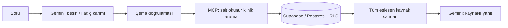

# NutriCare 🌿

**Beslenme ve ilaç–besin etkileşimleri için kaynaklı sohbet asistanı.**

[🌐 Canlı uygulama — www.nutricaretek.com](https://www.nutricaretek.com)

NutriCare, sorudaki besin ve ilaç adlarını çıkarır; Supabase/Postgres kayıtlarını MCP üzerinden sorgular ve yanıtını ilgili kayıtlar ile kaynaklarına dayandırır. Veri bulunmadığında bunu belirtir. Belirsiz klinik durumlarda hekime danışmayı önerir; kendisini gerçek hekim olarak tanıtmaz, tanı veya kişiye özel reçete üretmez.

## Kısa tanıtım

## Mimari

İlk veri seti 159 satır içerir. 

## Teknoloji ve teşekkür

Next.js · React · TypeScript · Tailwind CSS · Supabase Auth/Postgres · Google Gemini · Model Context Protocol SDK.

NutriCare, [Chatbot UI](https://github.com/mckaywrigley/chatbot-ui) tabanından geliştirilmiştir. Lisans bilgileri [license](license) dosyasındadır.

